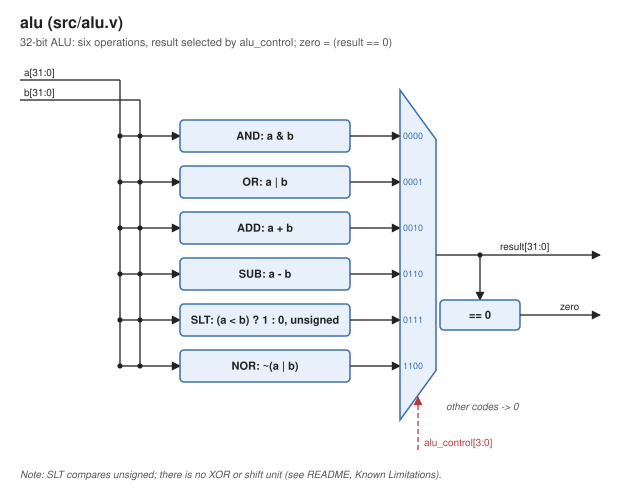
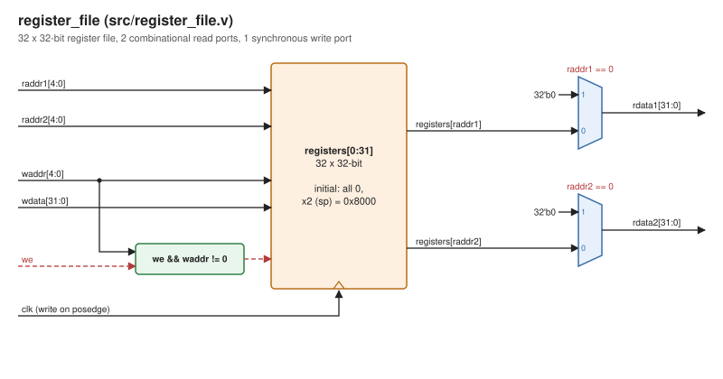
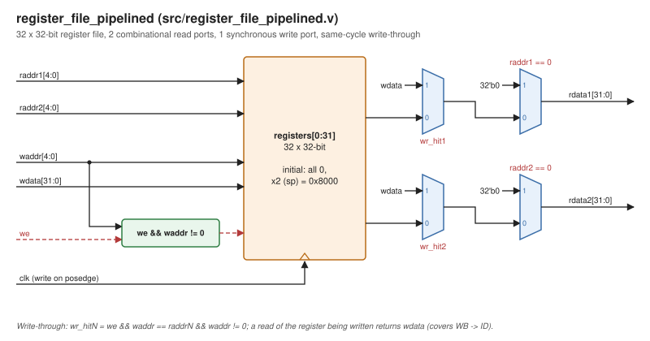
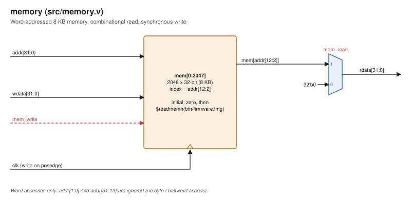
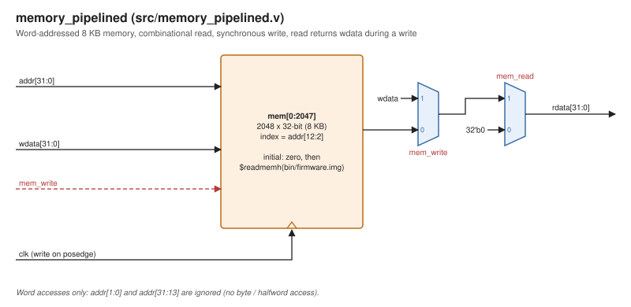
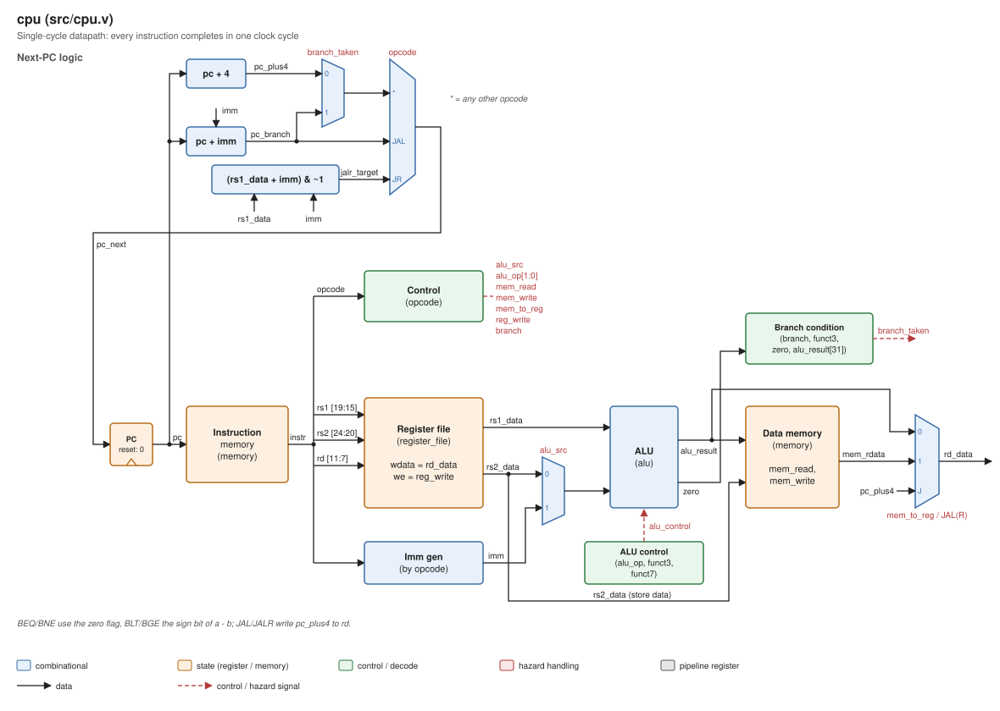
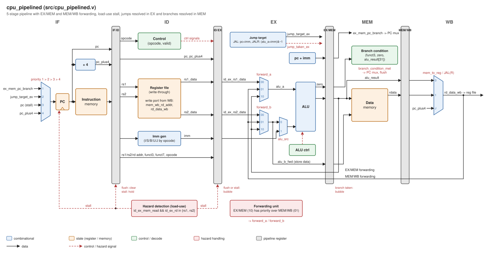

# Schematics

Block-level schematics of every module in `src/`, drawn from the RTL.

| Module | Schematic |
|---|---|
| `alu` |  |
| `register_file` |  |
| `register_file_pipelined` |  |
| `memory` |  |
| `memory_pipelined` |  |
| `cpu` (single-cycle) |  |
| `cpu_pipelined` |  |

Colors: blue = combinational, orange = state (registers / memories), green = control / decode, red = hazard handling, grey = pipeline register. Solid lines are data, dashed red lines are control / hazard signals. A wire ending in a name only (no source drawn) is a net label: it connects to the signal of that name.

## Regenerating

The SVGs are generated by `gen_schematics.py` (Python 3, standard library only):

```bash
python3 docs/schematics/gen_schematics.py
```

The drawings are written by hand from the RTL, not extracted from it. When a module changes, update its function in the script and regenerate.
